**Une question sur mon parcours ? Rouba, mon assistante, vous répond.**

---

<b>Qui est Rouba ?</b>

 

Ingénieure diplômée en Intelligence Artificielle et Business Intelligence (ESPRIT, 2026), avec une expérience confirmée en agents conversationnels IA (LangGraph, RAG, NLP), en pipelines de données et en plateformes SaaS multi-tenant déployées en production chez de vrais clients.

<b>Sur quoi je travaille en ce moment</b>

 

**Développeuse IA chez Boldys AI** (2026 – aujourd'hui), conception de produit IA. Je construis WaaS, une plateforme SaaS d'automatisation conversationnelle sur WhatsApp Business :

- moteur multi-agents LangGraph / LangChain avec GPT-4o, RAG et bases de connaissances par client
- réservation de créneaux dans la conversation, intégration calendrier via MCP
- 23 fonctionnalités en production : qualification de leads, relances automatisées, intervention humaine, alertes Slack
- 32 tests automatisés (Django, Vitest), 100 % de couverture des règles métier critiques
- échanges directs avec les clients : recueil des besoins, démos, traitement des retours
- Django, Celery, Redis, PostgreSQL, Docker, Coolify

<b>Parcours</b>

 

| Année | Rôle |
|---|---|
| 2026 – | Développeuse IA — Boldys AI |
| 2025 | Ingénieure logiciel, PO & QA — Advyteam Accretio & INRAE (Lyon) |
| 2024 | Ingénieure ERP, intégration logicielle (projet WMS) — ISEP Paris & ESPRIT |
| 2023 | Ingénieure Cloud ERP, administration système & data — Sekceram (Algérie) |

<b>Projets</b>

 

- **[Baebles](https://baebles.com)** — application communautaire gratuite pour les lecteurs de fantasy : salons par sous-genre, recommandations, suivi des sorties (iOS & Android)
- **[Banti](https://banti.app)** — mise en relation entre fondateurs, experts et investisseurs, avec matching intelligent
- Étude NLP / RAG de l'impact de l'IA sur le marché de l'emploi
- Classification d'œuvres d'art par CNN (WikiArt)
- Smart Healthcare Predictor — Angular, Flask, Power BI

<b>Stack</b>

 

           

<b>Formation</b>

 

| Années | Établissement |
|---|---|
| 2023 – 2026 | ESPRIT — Diplôme National d'Ingénieur, Intelligence Artificielle & Business Intelligence |
| 2020 – 2023 | FSM Monastir — Cycle préparatoire, Mathématiques-Physique |
| 2019 – 2020 | Baccalauréat Sciences expérimentales — Lycée Route de la Plage, Soliman |

<b>Certifications</b>

 

NVIDIA Deep Learning · NVIDIA Generative AI Explained · Microsoft Dynamics 365 Fundamentals · AWS Cloud Foundations · Hashgraph Developer · Mastering Maven

<b>Vie associative & leadership</b>

 

- **Advisor (actuellement)** — IEEE Women in Engineering Affinity Group, ESPRIT
- Mentor (auparavant) — IEEE ESPRIT Student Branch
- Vice-Présidente — IEEE ESPRIT Student Branch
- Secrétaire Générale — IEEE Computer Society (chapitre ESPRIT)
- Vice-Présidente — WIE ACT 3 Congress
- Responsable Ressources Humaines — IEEE ESPRIT, TAPSES, clubs CTS
- Coordinatrice logistique — Hult Prize ESPRIT
- Participante — IEEE Region 8 SYP Congress, Grenoble
- Membre active — Enactus ENIM, Spark Club BIAT, British Council Debate Club

<b>En dehors du code</b>

 

Violon · Natation · Jogging · Lecture · Anime · Séries

<b>Langues</b>

 

Arabe (maternelle) · Français (courant) · Anglais (courant) · Allemand (A2)

<b>Disponibilité</b>

 

Je cherche un poste à temps plein d'ingénieure IA / Data, disponible immédiatement.
Email : [roubasouidi.pro@gmail.com](mailto:roubasouidi.pro@gmail.com) · LinkedIn : [rouba-souidi-20062001rs](https://linkedin.com/in/rouba-souidi-20062001rs)

---

*« The best way to predict the future is to invent it. »* — Alan Kay

